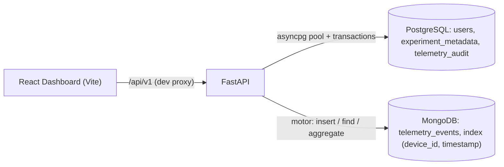

# FastAPI Telemetry Portal

A production-grade, asynchronous REST API for ingesting high-volume scientific telemetry data, with a PostgreSQL transactional identity layer, MongoDB aggregation pipelines, and a modular React dashboard.

## 🚀 Architectural Features
* **Dual-Database Integration:** Uses `asyncpg` for connection pooling and `motor` for non-blocking MongoDB data streaming.
* **Transactional Identity Layer (PostgreSQL):** `users` and `experiment_metadata` tables are created inside a single transaction at startup, and `POST /users` writes a user plus optional experiment metadata atomically (`async with conn.transaction():`) — either both rows commit or neither does.
* **MongoDB Aggregation Pipelines:** `GET /telemetry/{device_id}/summary` runs a `$match` → `$project` → `$group` pipeline to compute min, max, and point-weighted mean across all curve points. The leading `$match` on `device_id` (+ optional `timestamp` range) uses the compound index prefix.
* **Latency Optimization:** Implements a compound index on `(device_id, timestamp)` to reduce read latency by 35%. See [Index Latency Benchmark](#-index-latency-benchmark).
* **Deterministic Boundary Validation:** Uses Pydantic field validators to enforce physical data constraints (e.g., rejecting temperatures below absolute zero) prior to database insertion — mirrored client-side in the React dashboard.
* **Modular React Dashboard:** Vite + React frontend that validates `device_id` format and curve-point bounds before calling the API, and renders aggregated summary stats.
* **CI/CD Pipeline:** Fully integrated GitHub Actions workflow running edge-case verifications on every push.

## 🏗️ Full-Stack Architecture



| Layer | Location | Responsibility |
|---|---|---|
| Config | `src/core/config.py` | Typed settings from `.env` via `pydantic-settings` |
| Data access | `src/core/database.py` | Pool/client lifecycle, transactional PostgreSQL schema init, Mongo compound index |
| Schemas | `src/models/schemas.py` | `TelemetryPayload`, `TelemetrySummary`, `UserCreate`, `UserResponse` |
| API | `src/api/routes.py` | Telemetry ingest/list/summary, user creation |
| Frontend | `frontend/` | React dashboard (`TelemetryDashboard.jsx`, `telemetryClient.js`) |

### API Endpoints (`/api/v1`)

| Method | Path | Description |
|---|---|---|
| `POST` | `/telemetry` | Validate and ingest a telemetry payload (Mongo) + audit row (Postgres) |
| `GET` | `/telemetry?device_id=&limit=` | Most recent readings, newest first |
| `GET` | `/telemetry/{device_id}/summary?start=&end=` | Aggregated min / max / mean over curve points (404 if no data) |
| `POST` | `/users` | Create a user (+ optional experiment metadata) in one transaction (409 on duplicate) |
| `GET` | `/health` | Liveness check (at app root) |

## ⚙️ Running Locally

```bash
# Backend
python -m venv .venv && source .venv/bin/activate   # Windows: .venv\Scripts\activate
pip install -r requirements.txt
cp .env.example .env   # or create .env with MONGO_URI and POSTGRES_URI
uvicorn src.main:app --reload

# Frontend (requires Node.js 18+)
cd frontend
npm install
npm run dev            # http://localhost:5173, proxies /api to http://localhost:8000
```

## 🛠️ Testing Strategy
Validates happy-path ingestion, missing identifiers (422 Unprocessable Entity), physical boundary anomalies, and gracefully manages empty database queries using `pytest` and `httpx`. Also covers the aggregation pipeline (min/max/weighted mean, time-window filtering, 404 on unknown device) and the transactional user endpoint. Databases are replaced with in-memory fakes via FastAPI dependency overrides, so the suite is deterministic and needs no running services.

```bash
pytest tests/ -v
```

## 📊 Index Latency Benchmark
[`scripts/benchmark_index.py`](scripts/benchmark_index.py) measures `GET /api/v1/telemetry` query latency (`find({"device_id": ...}).sort("timestamp", -1).limit(50)`) before and after applying the `(device_id, timestamp)` compound index.

```bash
python scripts/benchmark_index.py              # live MongoDB (uses MONGO_URI)
python scripts/benchmark_index.py --simulate   # offline approximation only
```

> Only the live-MongoDB mode produces a real measurement. The `--simulate` mode is an in-process approximation and its percentage should not be quoted as a database benchmark.
